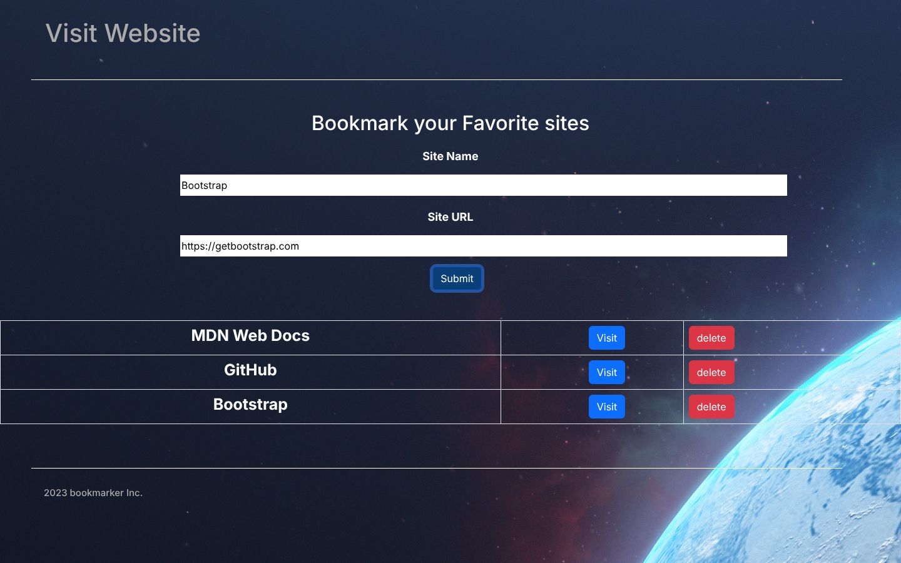
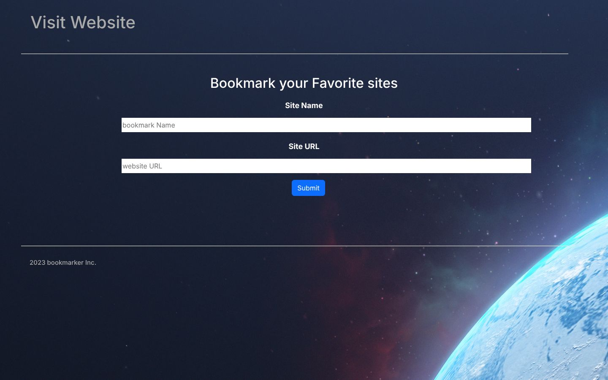

<div align="center">

# Visit Website

### A small bookmark manager: save a site's name and URL, then visit or delete it

A vanilla JavaScript practice app from my 2022 front-end training. You add bookmarks through a form and they appear in a table with **Visit** and **Delete** buttons, rendered from a JavaScript array.

[](https://developer.mozilla.org/docs/Web/HTML)
[](https://developer.mozilla.org/docs/Web/CSS)
[](https://developer.mozilla.org/docs/Web/JavaScript)
[](https://getbootstrap.com)
<br>
[](https://eslamraafat1.github.io/Visit-Website/)

**[Live demo](https://eslamraafat1.github.io/Visit-Website/)** ·
**[Portfolio](https://new-portfolio-ashy-xi.vercel.app/)** ·
**[LinkedIn](https://www.linkedin.com/in/eslamraafat-dev/)** ·
**[Email](mailto:eslamraafat736@gmail.com)**

<br>



</div>

<table>
  <tr>
    <td width="40%"></td>
    <td width="60%"></td>
  </tr>
  <tr>
    <td align="center"><sub>Mobile (iPhone 13)</sub></td>
    <td align="center"><sub>Empty state on desktop</sub></td>
  </tr>
</table>

---

## Overview

A **learning project** from my 2022 front-end course (the classic "bookmarker" CRUD task). It practises the basic data → DOM loop: keep the state in an array, rebuild the table from it after every change.

## Features

- **Add a bookmark:** site name and URL go into an array of objects, and the table is re-rendered.
- **Delete:** removes the row by its index with `Array.prototype.splice` and re-renders.
- **Visit:** opens a URL in a new tab with `window.open(url, "_blank")`.
- Bootstrap table and buttons over a full-page space background.

### Known limitations

Kept as written for the course:

- Bookmarks live only in memory, so they are gone after a reload (there is no `localStorage` yet).
- **Visit** opens whatever URL is currently in the input, not the URL saved on that row.
- The name and URL validators are started but not finished (the regexes are written as strings).
- The page has no `<meta name="viewport">`, and the background image is about 11.8 MB, so the first load is slow.

## Tech stack

| Layer | Tools |
| --- | --- |
| Markup and styles | HTML5, CSS3, Bootstrap 5.2 (local copy) |
| Scripting | Vanilla JavaScript |
| Icons | Font Awesome Free 6.1.2 (local copy, linked) |
| Hosting | GitHub Pages |

## Project structure

```text
.
├── index.html            # form + bookmarks table
├── style.js              # add / render / visit / delete
├── style.css
├── bootstrap.min.css · bootstrap.bundle.min.js
├── font/ · webfonts/     # Font Awesome
├── image/                # background image
└── docs/screenshots/     # README images
```

## Getting started

No build step. Open `index.html` in a browser, or serve the folder:

```bash
git clone https://github.com/Eslamraafat1/Visit-Website.git
cd Visit-Website
npx serve .          # http://localhost:3000
```

## Deployment

Hosted on **GitHub Pages** from the `master` branch: **https://eslamraafat1.github.io/Visit-Website/**

## Author

**Eslam Raafat**, Front-End Developer (React · Next.js · TypeScript)

- **Portfolio:** [new-portfolio-ashy-xi.vercel.app](https://new-portfolio-ashy-xi.vercel.app/)
- **LinkedIn:** [linkedin.com/in/eslamraafat-dev](https://www.linkedin.com/in/eslamraafat-dev/)
- **GitHub:** [@Eslamraafat1](https://github.com/Eslamraafat1)
- **Email:** [eslamraafat736@gmail.com](mailto:eslamraafat736@gmail.com)
